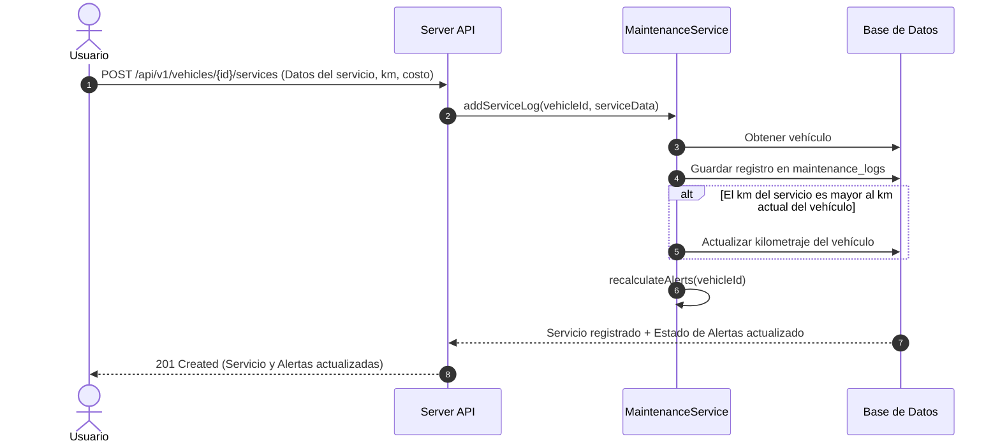
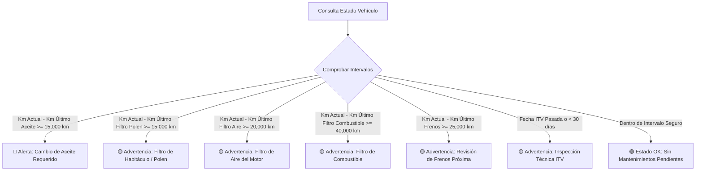

# Arquitectura del Sistema: AutoCare Garage

## 🏗️ Arquitectura General
El sistema **AutoCare Garage** utiliza una **Arquitectura en Capas (Layered Architecture)** con separación limpia entre la persistencia de datos, la lógica de cálculo de alertas preventivas y la interfaz de usuario web.

```
[ Cliente Web / Dashboard ]
           │
           ▼ HTTP / REST API
[ Controller Layer (server.js) ]    <-- Validación DTO y Respuestas JSON
           │
           ├──────────────────────────────┐
           ▼                              ▼
[ Service Layer (maintenanceService.js) ] [ Logger Module (logger.js) ]
           │                              │
           ▼                              ▼
[ Data Access Layer (db.js) ]        [ activity.log ]
(SQLite Relacional Local)            (Auditoría y Trazabilidad)
```

---

## 📊 Diagramas de Flujo (Mermaid)

### 1. Flujo de Registro de Mantenimiento y Cálculo de Alerta


### 2. Flujo de Evaluación Preventiva de Alertas


---

## 💡 Algoritmo de Alertas Preventivas
El sistema calcula el estado de cada vehículo evaluando las especificaciones del fabricante e intervalos estándar de la industria (los mantenimientos específicos como cadenas/correas o sustituciones adicionales pueden registrarse de forma manual en "Otros Servicios"):

| Componente | Intervalo Recomendado | Frecuencia de Revisión |
| :--- | :--- | :--- |
| **Cambio de Aceite & Filtro** | Cada `15.000 km` o `1 año` | En cada mantenimiento básico. |
| **Filtro de Habitáculo (Polen)** | Cada `15.000 – 20.000 km` o `1 año` | Al inicio de primavera o antes del verano. |
| **Filtro de Aire del Motor** | Cada `15.000 – 30.000 km` o `2 años` | En cada cambio de aceite (limpiar si hay polvo). |
| **Filtro de Combustible** | Diésel: `30.000 – 60.000 km` / Gasolina: `40.000 – 80.000 km` | Cada 2 años o en mantenimiento mayor. |
| **Revisión de Frenos (Pastillas/Discos)** | Cada `25.000 km` | En cada mantenimiento preventivo. |
| **Inspección Técnica (ITV)** | Anual o según antigüedad del vehículo | Según fecha límite oficial. |
| **Otros Servicios (Cadenas/Correas/Varios)** | Manual / Según vehículo | Registrar en 'Otros Servicios'. |

---

## 📝 Sistema de Registro de Auditoría Local (`activity.log`)
El sistema cuenta con un módulo de logging (`src/utils/logger.js`) que escribe síncronamente en el archivo local `data/activity.log`.

Se registran con marca temporal (`YYYY-MM-DD HH:MM:SS`):
- **Ciclo de vida de la app**: `INICIO_APP` y `FIN_APP` (capturando señales `SIGINT`, `SIGTERM`, `SIGHUP`).
- **Gestión de Vehículos**: `NUEVO_VEHICULO`, `ACTUALIZAR_KILOMETRAJE`, `ACTUALIZAR_ITV`, `ELIMINAR_VEHICULO`.
- **Gestión de Servicios**: `NUEVO_SERVICIO`, `ACTUALIZAR_SERVICIO`, `ELIMINAR_SERVICIO`.

